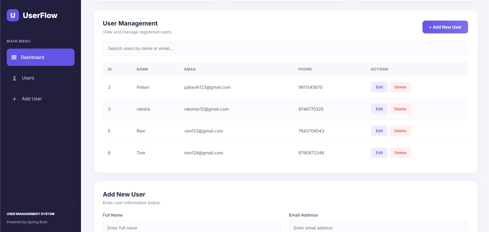
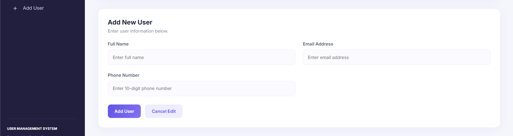
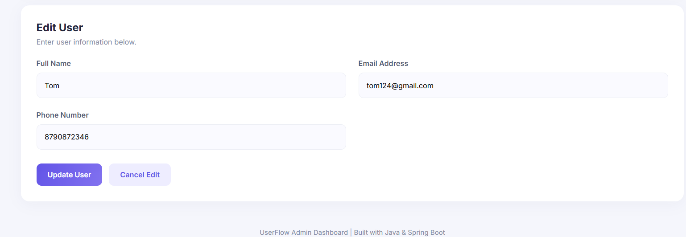
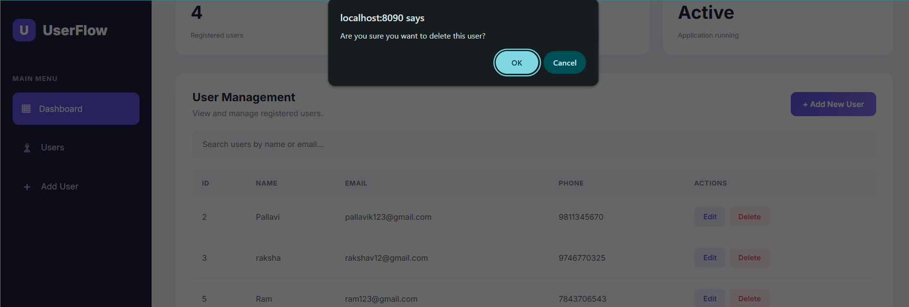

# User Management System

A web-based User Management System developed using Java, Spring Boot, MySQL, HTML, CSS, and JavaScript. This application allows users to manage user records through basic CRUD operations.

## Features

- Add new users with Name, Email, and Phone Number.
- View all registered users in a table.
- Edit and update existing user details.
- Delete user records.
- Search users by name or email.
- Basic form validation.

## Technology Stack

| Component | Technology |
|---|---|
| Backend | Java, Spring Boot |
| Database | MySQL |
| ORM | Spring Data JPA |
| Frontend | HTML, CSS, JavaScript |
| Build Tool | Maven |

## Project Structure

```text
user-management/
├── src/
│   ├── main/
│   │   ├── java/com/iraasoft/usermanagement/
│   │   │   ├── controller/
│   │   │   ├── entity/
│   │   │   ├── repository/
│   │   │   ├── service/
│   │   │   └── UserManagementApplication.java
│   │   └── resources/
│   │       ├── static/
│   │       │   ├── index.html
│   │       │   ├── style.css
│   │       │   └── script.js
│   │       └── application.properties
│   └── test/
└── pom.xml
```

## Database Configuration

1. Install and start MySQL.
2. Create a database named `user_management`.
3. Configure your MySQL password using the `DB_PASSWORD` environment variable.

The application uses the following database configuration:

- Database: `user_management`
- Username: `root`
- Password: `${DB_PASSWORD}`

## How to Run the Project

1. Clone the repository:

```bash
git clone https://github.com/pallavik47/Iraasoft-User-Management-System.git
```

2. Open the project in your IDE.

3. Set the `DB_PASSWORD` environment variable to your MySQL password.

4. Run the application on Windows:

```bash
mvnw.cmd spring-boot:run
```

5. Open your browser:

```text
http://localhost:8090
```

## Application Screenshots

### Dashboard


### Add User


### Update User


### Delete User


## Author

Pallavi K
